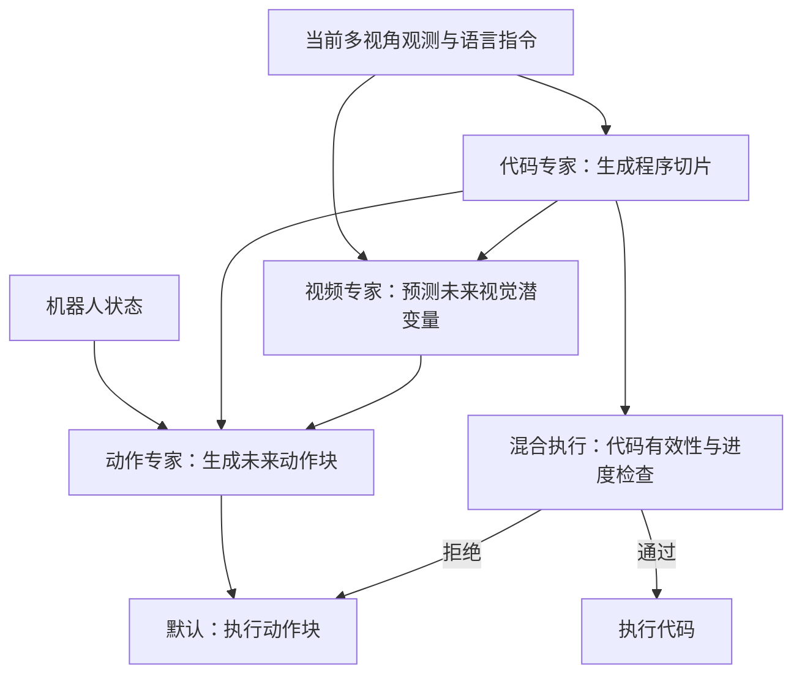

# AW-0：从 Agent 编程到世界动作模型的代码导读

核对日期：2026-10-31。论文为 [Agentic World Action Models](https://arxiv.org/abs/2610.30136v1)，2026-10-21 发布。方法名 AW-0。

你的仓库：[The-Sincere/agentic-wam](https://github.com/The-Sincere/agentic-wam)，已核验为 [官方仓库](https://github.com/ZhuoyangLiu2005/agentic-wam) 的 Fork。本文源码链接固定到提交 `275818e5787d59012eba4c43504342f1201ad25b`。

本次为论文收录和静态代码阅读，没有安装训练环境、下载模型权重、运行机器人或复现论文结果。中文内容是导读，不是整篇论文的逐段翻译。

## 先抓住它与你已读论文的关系

CaP-X 帮你理解编码 Agent 如何组合感知和控制基元；ASPIRE 关注失败诊断、程序修复与技能积累；ENPIRE 关注真机自动实验闭环；AW-0 进一步把代码规划放进模型内部，与未来视频和动作共同生成。

这里可以同时补你学习地图中的三个方向：**动作模型的输入输出、世界模型的预测、可复用技能与神经策略的结合**。论文名称中的 agentic 不表示它只是给一个原有 VLA 外挂聊天规划器。

## 模型里有三个专家

箭头表达主要条件依赖；在联合模式下，三条流在同一迭代去噪过程中更新，不是先完整生成代码、再完整生成视频、最后生成动作的单次串行流水线。真实注意力还包含各流内部和观测前缀的约束，以代码掩码为准。

“专家”在这里指神经网络模块，区别于 ASPIRE 中分别承担协调、编程和验证工作的多个编码智能体。

## 推荐顺序：先读这八个入口

| 顺序 | 入口 | 重点问题 |
|---|---|---|
| 1 | [README：48–90 行][readme] | 三种输出是什么？哪些权重和数据真正开放？ |
| 2 | [模型配置：12–67 行][config] | 代码目标、动作维度、记忆模块实际开了什么？ |
| 3 | [generic_mot.py：80–134 行][mot] | 三个专家如何保留自己的参数，又在每层交换信息？ |
| 4 | [agenticwam_model.py：475–523 行][mask] | 谁能读谁？代码、视频、动作的依赖方向是什么？ |
| 5 | [同文件：1101 行起][joint]，配合 [1438–1461 行][infer-entry] | 怎样一起去噪？联合模式的入口在哪里？ |
| 6 | [标注说明：117–157 行][annotation] → [library.py：49–100 行][library] | 技能标签怎么来、为什么冻结、哪些检查由代码落实？ |
| 7 | [arbiter.py：580–725 行][arbiter] | 生成代码什么时候执行，什么时候交给动作通道？ |
| 8 | [code_memory.py：20–80 行][memory] | 当前回合的程序历史怎样压缩成条件前缀？ |

第一遍跳过大模型权重加载、分布式训练、底层驱动和数值优化细节。先追清输入、输出、分支条件、状态更新。

## 第 1 站：把“代码作为规划”与“代码直接执行”分开

论文 §2.3 明确说明：**默认模式不执行生成的代码。** 代码向视频和动作专家提供规划条件，由动作专家的动作块控制机器人。

混合执行模式才额外尝试把代码交给感知／控制 API。通过检查后，代码承担当前阶段；被拒绝则使用动作预测通道。因此读实验时要分别看 WAM 与 hybrid，不要把两者当成同一种执行机制。

自查问题：如果生成的程序只作为内部条件，模型生成一段看起来合理的程序，是否已经证明这段程序能独立控制机器人？答案是否定的，独立执行需要另测。

## 第 2 站：用配置核对实际模型

`configs/model/agenticwam_cosmos.yaml` 是很好的总索引：

- `use_code_expert: true`：启用代码专家；关闭后走视频＋动作的两专家形式。
- `code_objective: joint`：默认联合掩码去噪；仓库也保留 `ar`、`blockdiff` 等路径。
- `action_dim: 64`、`proprio_dim: 64`：真实机器人统一动作／状态表示的默认配置；RoboTwin 任务配置会改为 14 维关节表示。
- `code_memory: false`：这一基础配置中，学习式程序记忆默认关闭；任务覆盖配置是否开启，需要另外检查。

特别注意：注释可能保留历史描述。例如某些注释写“默认关闭”，但对应键值可能已经启用。做复现应核对合并后的实际配置和入口分支，不能只读一句注释。

## 第 3 站：MoT 的核心只有一段循环

在 `GenericMoT.forward` 中，追这五步：

1. 每个专家分别计算该层的 Q、K、V。
2. 按 token 维拼接各专家的 Q、K、V。
3. 在指定注意力掩码下做混合注意力。
4. 把输出按各专家 token 长度切回去。
5. 每个专家继续自己的后处理和下一层。

这能帮你理解“联合”：它们共享信息交互，但不是所有专家都共享同一套参数。也不要把 MoT 直接等同于按 token 稀疏选择专家的 MoE。

## 第 4 站：看掩码，比只看架构图更准确

在 `_build_mot_attention_mask` 中，重点看：

- 第 491–493 行：视频内部、动作内部，以及动作读取完整视频 token 的许可。
- 第 497–509 行：不同代码目标对应不同的代码内部注意力。
- 第 511–522 行：代码流从自己的观测／指令前缀规划，视频读取代码，动作读取代码。

因此，联合生成不等于跨模态可以任意双向读取。不要仅凭方法名或旧函数注释画出错误的信息方向。

## 第 5 站：联合去噪从哪里开始

先读 `infer_action_trimodal` 第 1456–1461 行：`code_objective == "joint"` 时，它转到 `_infer_action_joint`。

在联合路径中，未来视频和动作从噪声表示开始，代码从掩码 token 开始；每次迭代通过三专家模型更新连续生成状态，并逐步确定代码 token。

不用一开始就推所有流匹配公式。先回答：输入条件是什么、循环中更新哪些变量、代码 token 如何逐步确定、返回的动作块与代码分别交给谁。

训练则从 [training_loss：525 行起][loss] 进入，区分连续视频／动作目标与离散掩码代码目标。

## 第 6 站：技能库首先服务于数据标注

`docs/CODE_ANNOTATION.md` 说明了：抽样标注 → 挖掘和接纳技能 → 冻结库 → 扩展整个语料的程序标签。

`codegen/pretrain/skill_library/{yam,ego}/` 存放两种具身设定下的技能。每个技能有 `skill.py` 和 `SKILL.md`；模型训练要用的代码标签，来自演示数据与这些 API／技能的对齐。

这里最值得联系你之前“基元是否涌现”的问题：

- [YamBimanualApi：1–22 行][api] 明确是 **declaration-only**，只是提供词汇、参数和契约，没有绑定执行后端。
- 人类设定接口边界，编码智能体在其上组合技能；标注程序不是逐个真实执行的控制程序。
- `validate_skill_source` 检查一个函数、`robot` 首参、允许的 API 调用、参数与词汇等；所查库还要求技能体是可展开的直线代码，禁止技能内部循环／分支和嵌套技能调用。
- 冻结之后改库会改变提示词版本并使旧标签失效。这种一致性约束与部署时持续收录新策略，是不同的问题。

不能把“通过语法、接口或接触对齐检查”自动称为“物理操作一定成功”。

## 第 7 站：混合仲裁器值得重点看

`HybridArbiter.on_replan` 判断代码能否承担本轮重规划。阅读顺序：

1. 第 592–619 行：阶段编号、重复阶段、失败次数预算。
2. 第 629–647 行：依赖变量是否齐全。
3. 第 648–696 行：修复路径与调用白名单。
4. 第 697–722 行：空代码、没有变化的重复失败等。
5. 第 723–725 行：代码执行通道接管当前重规划点。

被拒绝时返回 `False`，上层可继续使用 WAM 动作；被代码通道消耗时返回 `True`，需要丢弃该轮新生成的 WAM 动作块并重新观测。不要在代码已经移动机器人之后，继续照旧执行同一份动作块。

该实现包含代码修复和近邻修复等条件路径。评测时应记录实际执行的是原始输出还是修复版本、各通道接管比例、失败和回退原因。

论文对仿真混合模式还使用另外采集的 CaP 演示。对比纯动作与混合结果时，应同时核对训练数据和执行模式，不能把差异全部归因于一次通道切换。

## 第 8 站：程序历史不等于长期技能积累

`LearnedCodeMemory` 用固定数量的学习式槽位保存压缩后的程序信息；`write` 用交叉注意力和门控更新，`read` 返回供代码专家使用的前缀。

配合 [agenticwam_model.py：416–432 行][memory-build]，能看到从历史代码构建记忆的过程。该模块存在，不代表每个配置都开启；基础配置的 `code_memory` 为 `false`。

请把三层分开：

| 层次 | 内容 |
|---|---|
| 当前回合记忆 | 已生成的程序切片和当前任务进度 |
| 外部技能库 | 标注和程序复用所依赖的代码、文档和接口 |
| 模型权重 | 通过预训练、后训练学到的生成能力 |

AW-0 不能仅凭这些模块就被归为已经实现了无限在线自进化或完整的持续技能库接纳循环。

## 阅读与运行边界

官方公开代码和模型检查点，但未随仓库发布所有预训练语料和初始化视频检查点。从公开模型做后训练，与从零完整复现论文预训练，条件不同。

本次保留了你的 GitHub Fork 和这份导读；没有在笔记本上克隆整套仓库或启动大模型计算。

[readme]: https://github.com/The-Sincere/agentic-wam/blob/275818e5787d59012eba4c43504342f1201ad25b/README.md#L48-L90
[config]: https://github.com/The-Sincere/agentic-wam/blob/275818e5787d59012eba4c43504342f1201ad25b/configs/model/agenticwam_cosmos.yaml#L12-L67
[mot]: https://github.com/The-Sincere/agentic-wam/blob/275818e5787d59012eba4c43504342f1201ad25b/src/agenticwam/models/cosmos_mot/generic_mot.py#L80-L134
[mask]: https://github.com/The-Sincere/agentic-wam/blob/275818e5787d59012eba4c43504342f1201ad25b/src/agenticwam/models/cosmos_mot/agenticwam_model.py#L475-L523
[joint]: https://github.com/The-Sincere/agentic-wam/blob/275818e5787d59012eba4c43504342f1201ad25b/src/agenticwam/models/cosmos_mot/agenticwam_model.py#L1101-L1133
[infer-entry]: https://github.com/The-Sincere/agentic-wam/blob/275818e5787d59012eba4c43504342f1201ad25b/src/agenticwam/models/cosmos_mot/agenticwam_model.py#L1438-L1461
[annotation]: https://github.com/The-Sincere/agentic-wam/blob/275818e5787d59012eba4c43504342f1201ad25b/docs/CODE_ANNOTATION.md#L117-L157
[library]: https://github.com/The-Sincere/agentic-wam/blob/275818e5787d59012eba4c43504342f1201ad25b/codegen/pretrain/pipeline/codegen/library.py#L49-L100
[arbiter]: https://github.com/The-Sincere/agentic-wam/blob/275818e5787d59012eba4c43504342f1201ad25b/robotwin/hybrid_eval/arbiter.py#L580-L725
[memory]: https://github.com/The-Sincere/agentic-wam/blob/275818e5787d59012eba4c43504342f1201ad25b/src/agenticwam/models/experts/code_memory.py#L20-L80
[loss]: https://github.com/The-Sincere/agentic-wam/blob/275818e5787d59012eba4c43504342f1201ad25b/src/agenticwam/models/cosmos_mot/agenticwam_model.py#L525-L750
[api]: https://github.com/The-Sincere/agentic-wam/blob/275818e5787d59012eba4c43504342f1201ad25b/codegen/pretrain/pipeline/codegen/api/bimanual.py#L1-L22
[memory-build]: https://github.com/The-Sincere/agentic-wam/blob/275818e5787d59012eba4c43504342f1201ad25b/src/agenticwam/models/cosmos_mot/agenticwam_model.py#L416-L432
